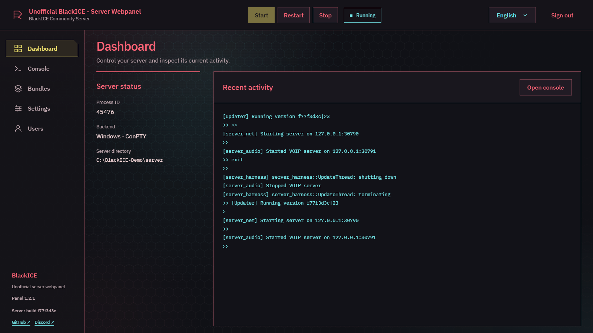
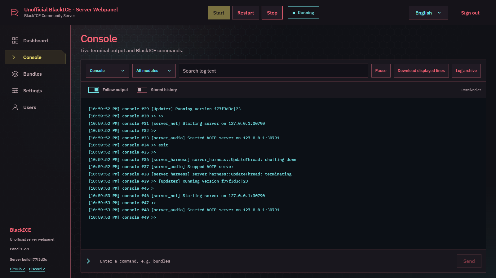
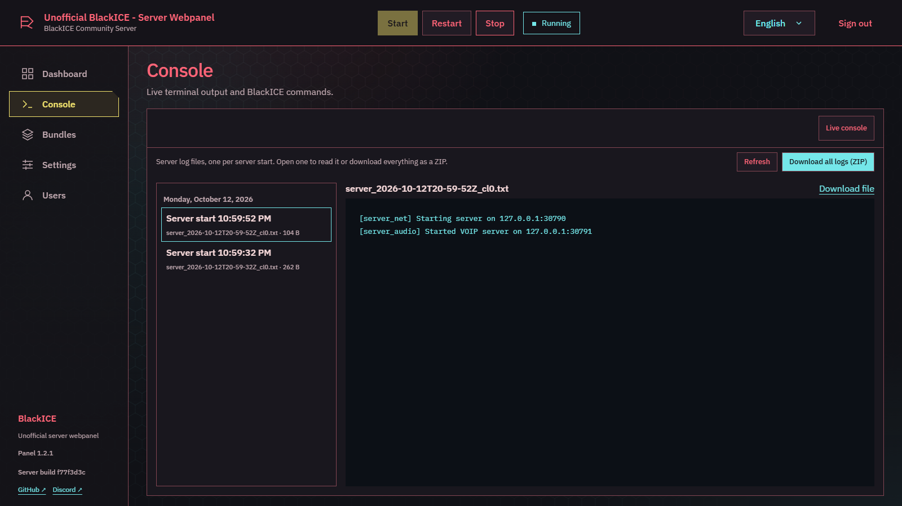
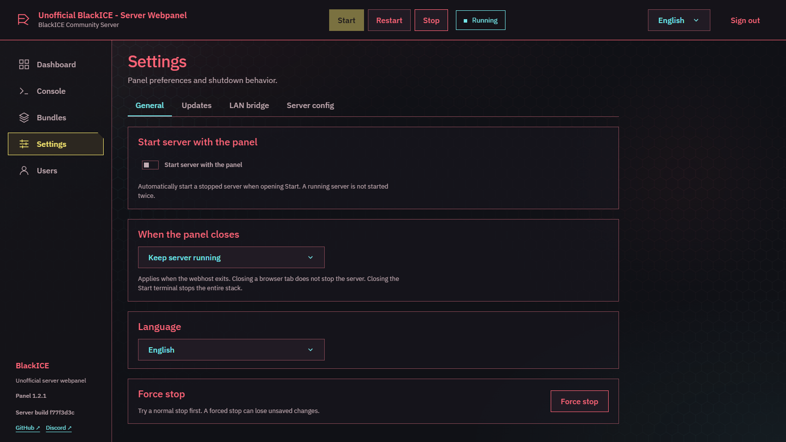
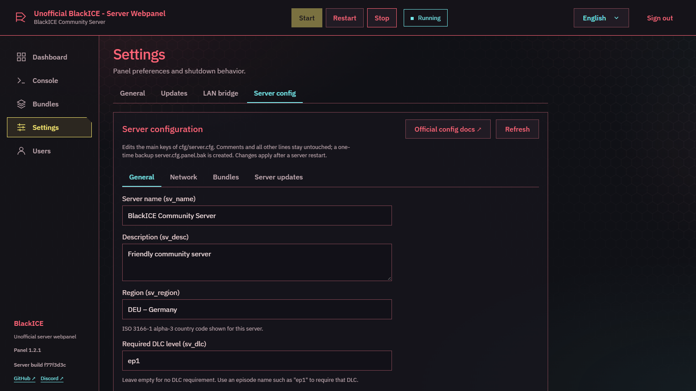
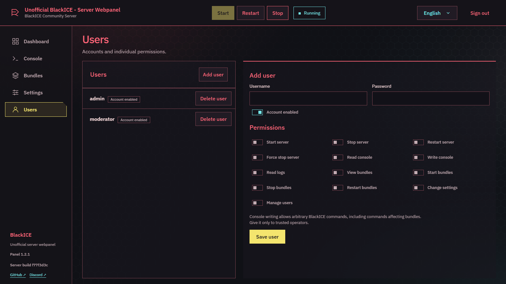
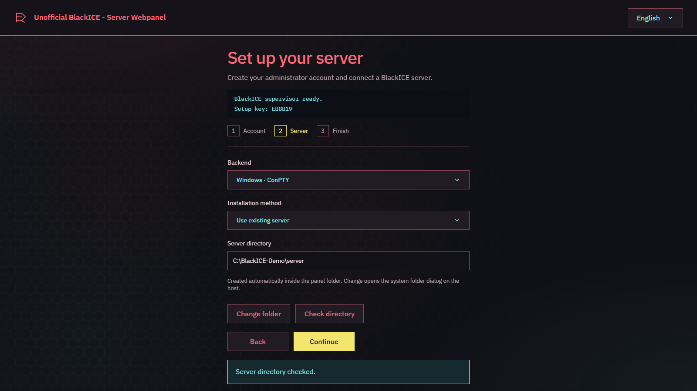
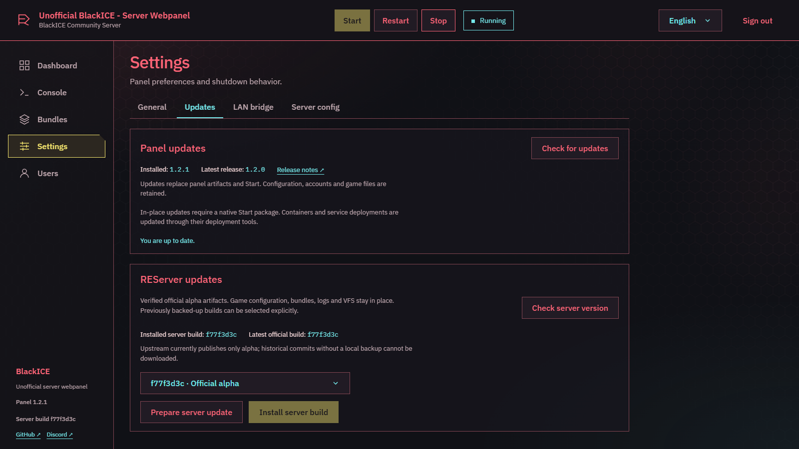

# BlackICE Server Panel

Dieses Projekt wurde überwiegend mit KI-Werkzeugen entwickelt und von seinem menschlichen Maintainer geprüft und getestet. Es begann als privates Projekt und wurde später für die Community geöffnet. Eine unabhängige Sicherheitsprüfung wurde nicht durchgeführt. Betreiber bleiben für ihren Einsatz verantwortlich; Code-Reviews, Verbesserungen und Fehlerberichte sind willkommen. Sicherheitsprobleme bitte über [private GitHub-Sicherheitsmeldungen](https://github.com/LandminenTester/blackice-server-panel/security/advisories/new), normale Fehler über Issues melden.

Inoffizielles Dashboard für eine **BlackICE-/REServer-Instanz**: Serversteuerung, Live-Konsole, Logs, Bundle-Verwaltung, mehrere Benutzer mit einzelnen Berechtigungen, Deutsch/Englisch, geschützte Ersteinrichtung, offizieller Serverdownload und Cyberpunk-inspiriertes Design.

[English](README.md) · [Neuestes Release](https://github.com/LandminenTester/blackice-server-panel/releases/latest)

## Screenshots

| | |
|---|---|
|  |  |
| **Dashboard**: Status, Steuerung und letzte Aktivität | **Live-Konsole**: Ausgabe, Filter und Befehle |
|  |  |
| **Log-Archiv**: ein Log pro Serverstart, ZIP-Download | **Einstellungen**: Autostart, Abschaltverhalten und Sprache |
|  |  |
| **Serverkonfiguration**: `server.cfg` bearbeiten inkl. Regionsliste | **Benutzer**: Zugänge und einzelne Berechtigungen |
|  |  |
| **Einrichtungsassistent**: geführte Ersteinrichtung | **Updates**: Panel- und REServer-Builds |

(Die Screenshots zeigen die englische Oberfläche.)

## Windows

1. `blackice-server-panel-win-x64.zip` herunterladen und in einen beschreibbaren Ordner **getrennt vom Spielserver** entpacken.
2. `Start.exe` öffnen und das Steuerterminal offen lassen.
3. http://127.0.0.1:20772 öffnen. Einrichtungsschlüssel aus dem Terminal oder `.local/supervisor.log` verwenden, Administrator anlegen und vorhandenen Server oder einen leeren Downloadordner auswählen.

Windows x86-64 erforderlich; .NET ist enthalten. SDK und Node.js sind nicht nötig. Der Spielserver öffnet eine eigene Konsole. Diese schließen stoppt das Spiel; Start schließen, Strg+C oder Q beendet den gesamten Stack. Autostart lässt sich unter Einstellungen aktivieren.

### Nicht signierter Download (Windows)

`Start.exe` und die übrigen Programmdateien sind **nicht code-signiert**, da dies ein freies Community-Projekt ohne bezahltes Signaturzertifikat ist. Windows kann deshalb Warnungen anzeigen; das ist zu erwarten und für sich allein kein Hinweis auf Schadsoftware:

- **SmartScreen: „Der Computer wurde durch Windows geschützt“**: auf **Weitere Informationen** und dann auf **Trotzdem ausführen** klicken.
- **Heruntergeladene ZIP wird blockiert**: Rechtsklick auf die ZIP, **Eigenschaften** öffnen, **Zulassen** anhaken und mit OK bestätigen, *bevor* entpackt wird. Sonst tragen alle entpackten Dateien die Markierung „aus dem Internet heruntergeladen“.
- **Fehlalarme von Virenscannern** sind bei unsignierten, eigenständigen Programmen möglich. Lade nur von der offiziellen [Releases-Seite](https://github.com/LandminenTester/blackice-server-panel/releases) dieses Repositories herunter und baue das Projekt im Zweifel selbst aus dem Quellcode ([docs/building.md](docs/building.md)); der gesamte Code ist offen.

## Natives Linux

Referenzplattform: Debian 13 x86-64 mit glibc. ARM und Alpine/musl werden nicht unterstützt. `blackice-server-panel-linux-x64.tar.gz` herunterladen, dann:

```sh
sudo apt update
sudo apt install ca-certificates libicu76 libssl3t64 libstdc++6 zlib1g tmux
mkdir -p ~/blackice-panel
tar -xzf blackice-server-panel-linux-x64.tar.gz -C ~/blackice-panel
cd ~/blackice-panel
chmod +x Start
./Start
```

Einrichtung unter localhost:20772 wie oben abschließen. Laufzeit und PTY-Helfer sind enthalten; der Serverdownload benötigt keinen Docker-Daemon. Per SSH verwendet die Serverkonsole tmux: C verbindet, Strg+B und danach D trennt die Ansicht. Auf dem Desktop `xterm` für eigene Terminalfenster installieren. [Dienste und Bibliotheksprüfung](docs/linux.md).

## Docker unter Linux

Voraussetzungen: Linux x86-64, Docker Engine und Compose v2. Ein natives Releasepaket für `deploy/` entpacken und `blackice-server-panel-docker.tar.gz` aus demselben Release laden.

```sh
gzip -dc blackice-server-panel-docker.tar.gz | docker load
cp deploy/compose.env.example .env
sudo mkdir -p /srv/blackice-panel/state /srv/blackice-panel/runtime /srv/blackice-server
sudo chown 10001:10001 /srv/blackice-panel/state /srv/blackice-panel/runtime /srv/blackice-server
sudo chmod 700 /srv/blackice-panel/state /srv/blackice-panel/runtime /srv/blackice-server
stat -c %g /var/run/docker.sock
```

In `.env` eintragen: `PANEL_STATE=/srv/blackice-panel/state`, `PANEL_RUNTIME=/srv/blackice-panel/runtime`, `SERVER_PATH=/srv/blackice-server`, `DOCKER_GID` mit der ausgegebenen Socket-Gruppen-ID und `PANEL_VERSION` passend zur Version des heruntergeladenen Docker-Archivs (zum Beispiel `1.4.0`). Dann:

```sh
docker compose --env-file .env -f deploy/compose.yaml up -d
docker compose --env-file .env -f deploy/compose.yaml logs supervisor
```

Unter localhost:20772 den ausgegebenen Einrichtungsschlüssel verwenden, Docker und `/server` wählen. Nur der Supervisor erhält den weitreichenden Docker-Socket, der Webhost nicht. Panelzustand und Spieldateien bleiben in Hostordnern. Beenden: `docker compose --env-file .env -f deploy/compose.yaml down`. [Docker-Details](docs/docker.md).

## Bedienung und Updates

Unter Einstellungen → Allgemein lässt sich der neue native Serverordner prüfen und speichern, wenn der Server gestoppt ist. Fehlende Ordner/Serverdateien werden im Header auf allen Seiten angezeigt und sperren Start/Neustart. Dateien werden nicht verschoben. Docker-Mounts über die Bereitstellung ändern.


- Header: Status, Starten, Neustarten und Stoppen. Geordneter Stop wartet bis zu 30 Sekunden; erzwungener Stop ist separat. Bundle-Aktionen warten auf Serverbestätigung.
- Benutzer: Rechte für Server, Konsole, Logs, Bundles, Einstellungen und Benutzerverwaltung einzeln vergeben. Konsolenschreibzugriff nur vertrauenswürdigen Administratoren geben.
- Einstellungen → Panel-Updates: stabile GitHub-Releases prüfen, mit SHA-256 verifizieren und mit Sicherung sowie Wiederherstellung bei Startfehlern installieren. Konfiguration, Benutzer und Spieldateien bleiben erhalten. Installation über native Startdateien; Docker/systemd werden über ihre Bereitstellungswerkzeuge aktualisiert. **0.5.1 → 1.0 einmal manuell ersetzen, da das Repository umbenannt wurde; `.local/` erhalten.** [Updates und Wiederherstellung](docs/updates.md).
- Browser-Tab schließen stoppt nichts. `keep-running` / `stop-server` steuert das Beenden des Webhosts; Start schließen beendet immer den gesamten Stack. Externe Server werden erkannt und nicht doppelt gestartet; ihre Konsole kann nicht übernommen werden.
- Ports: Spiel/Bundle-Download 20770 TCP/UDP, Voice 20771 TCP/UDP, Dashboard 20772 TCP auf localhost. Fernzugriff über dokumentierten [HTTPS-Reverse-Proxy](docs/operations.md).
- `.local/` und Spielserverordner sichern. Neue Downloads verwenden LAN-Modus und deaktivierte automatische Serverupdates. Öffentliche Server benötigen die [offizielle Registrierung](https://docs.replay.re/servers/registering/).

### Update-Kanal

Standardmäßig folgt das Panel nur stabilen Releases. Unter **Einstellungen → Updates** kann auf den Kanal **Experimentell** gewechselt werden, um Vorabversionen (`vX.Y.Z-experimental.N`) mit neuen, unfertigen Funktionen zu erhalten; siehe [docs/updates.md](docs/updates.md). Für Produktivserver wird Stabil empfohlen.

### Experimentelle Bundle-Tools

Der experimentelle Kanal ergänzt Bundle-ZIP-Uploads, vertrauenswürdige Quellprojekte und Builds, gemeinsame Git-Konten, Repositorysuche und Reviewabläufe. Standardmäßig deaktiviert. Die getrennten Rechte für Einstellungen, Werkzeuge, Konten und Builds nur vertrauenswürdigen Betreibern geben; Builds führen Projektcode auf dem Panel-Host aus. [Bundle-Tools und Sicherheitsgrenzen](docs/bundle-tools.md).

## Server-Updates und Bridge-Diagnose

REServer-Updates stehen jetzt unter Einstellungen bereit: offizielles Alpha prüfen, Dateien verifizieren und mit Laufzeitsicherung sowie Start-Rollback installieren. Aktuelles Alpha oder zuvor lokal gesicherten Build auswählen. [Serverupdate-Anleitung](docs/server-updates.md).

Die optionale LAN-Bridge ergänzt Health, Serverphase, Commit/Tick, zugeordnete Konsolenausgabe und cursorbasierte Modullogs. In Einstellungen aktivieren und ausdrücklich neu starten. **--mcp erzwingt sv_lan 1; öffentliche Server behalten PTY.** Historie bleibt lokal, standardmäßig sieben Tage / 100 MB, konfigurierbar. [Einrichtung und Kompatibilität](docs/bridge.md).

## Entwicklung

.NET SDK 10 und Node.js 24; Linux zusätzlich C-Compiler und tmux. [Buildbefehle und Fehlerdiagnose](docs/building.md) · [Architektur](docs/development.md) · [Berechtigungen](docs/users.md). Bridge-Protokoll und adaptierte Komponenten: [blackice-mcp von REPLAY.re](https://github.com/replayre/blackice-mcp), MIT; siehe [Drittanbieterhinweise](https://github.com/LandminenTester/blackice-server-panel/blob/373cd3962172771d1f0c5b8ca077529b5917a15f/THIRD_PARTY_NOTICES.md). Windows/Linux-CI prüft Backends, Anmeldung, Einrichtung, Bundles, Launcher und Update-Rollback. Docker-CI prüft echte Serverinstallationen.

## Links und Hinweise

[BlackICE von REPLAY.re](https://replay.re/) · [Offizielle Dokumentation](https://docs.replay.re/) · [Offizielles Account-/Serverpanel](https://panel.replay.re/) · [Forum](https://forum.replay.re/)

Community-Projekt unter MIT-Lizenz; keine Verbindung zu oder offizielle Unterstützung durch REPLAY.re, BlackICE oder CD PROJEKT RED. Eigenes Cyberpunk-inspiriertes Design; [visuelle Referenz](https://www.artstation.com/artwork/18mLB8), deren Bilder nicht ausgeliefert werden.

Experimentelle Bundle-Tools bieten Branch-Vergleich und Review-/Direkt-Merges, Review-Branches für Paketupdates, Kategorien und Suche sowie wiederherstellbare Autostart-Einstellungen und ausdrückliche Löschumfänge. Details: [Bundle-Tools](docs/bundle-tools.md) und [Berechtigungen](docs/users.md).
